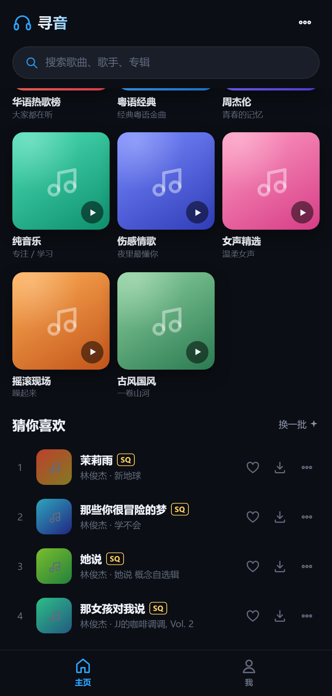
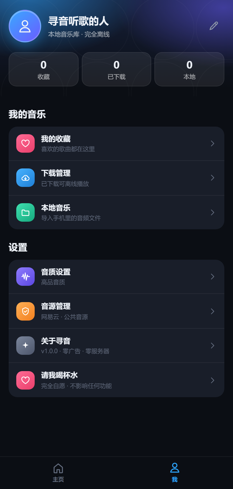
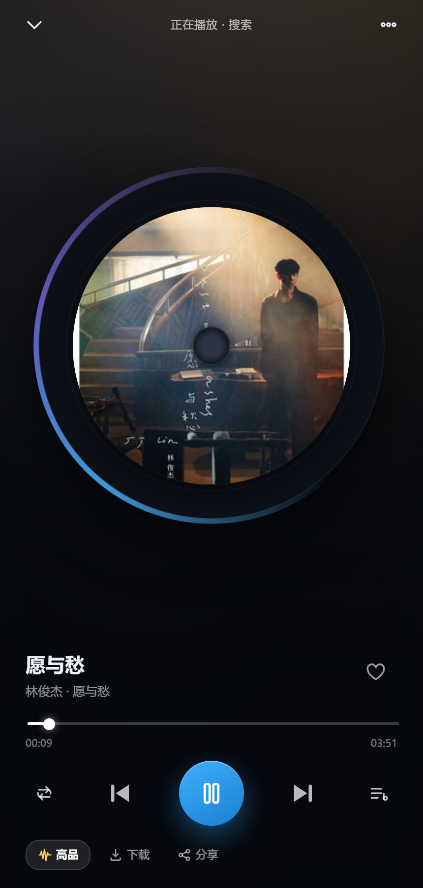

# 寻音 XunYin

一个完整的、可以真正装进手机的酷狗风格音乐播放器。
一套代码同时跑 **Android / iOS / 浏览器**，搜索 → 收藏 → 选音质下载 → 断网离线播放，全流程本地完成。

**不需要服务器、不需要账号、不需要订阅、不需要一直连着谁。** 音频文件存在手机本地数据库里，飞行模式照样听。

---

## 预览

| 主页 | 我的 | 播放 |
| --- | --- | --- |
|  |  |  |

> 截图来自真实运行：封面、歌曲、时长、歌词全部来自在线音源，非静态占位图。

---

## 一、先把结论说清楚

| 你要的 | 这个 App 怎么做到 |
| --- | --- |
| 界面像酷狗，好看 | 深色 + 蓝紫渐变，底部两个 Tab「主页 / 我」，全屏转盘播放器、迷你播放条、底部弹层，全部手写 CSS |
| 播放器里直接搜歌 | 顶部搜索框 → 搜索页，40 条结果带封面 / 歌手 / 专辑 / 音质角标 |
| 搜到能收藏、能下载 | 每首歌右侧三个按钮：收藏 ❤ / 下载 ⬇ / 更多 ⋯；下载时弹层选音质 |
| 三档音质（标准 / 高品 / 无损） | 标准 128kbps MP3、高品 320kbps MP3、无损 FLAC 原版文件，播放和下载可分别设默认档 |
| 下载的是原版文件 | 直接把音频二进制存进 IndexedDB，解出 Blob URL 播放，与在线路径完全解耦 |
| 断网也能听 | 播放时优先取本地文件，取不到才走网络；首页顶部会提示"已断网" |
| 装到安卓和 iOS | ① iOS Safari「添加到主屏幕」② 安卓 Chrome「安装应用」或装 APK ③ GitHub Actions 一键出 APK |
| 不花钱 | 无后端、无云服务、无广告位、无内购。整个 App 静态托管即可，GitHub Pages / Vercel 免费额度足够 |

---

## 二、装进手机（三种方式，从快到慢）

### 方式 A：iOS —— 30 秒，最推荐

1. 把 `www/` 目录部署到任意 **HTTPS** 静态托管（见下方"三、部署"）。
2. iPhone 用 **Safari** 打开那个网址。
3. 点底部 **分享** → **添加到主屏幕** → 完成。

主屏幕会多一个图标，点开是全屏无地址栏的原生观感，**离线可用**（Service Worker 缓存了全部界面代码，音频在你的本地库里）。
这是 iOS 上零成本、无需签名、不会被 7 天过期的最省事路径。

> 想装真正的 `.ipa`：见方式 C 的 iOS 部分，产物是未签名 App，需要用 Sideloadly / AltStore 用你自己的 Apple ID 签名安装（免费 Apple ID 每 7 天需重签一次，这是苹果的限制，任何第三方工具都一样）。

### 方式 B：Android —— Chrome 安装 或 装 APK

**B2（真 APK，已经在仓库里编好了）**

```
dist/whalemusic-v1.0.0.apk      ← 0.41 MB
```

**手机同 WiFi 直接装**：电脑上跑 `node tools/serve.js 8899`，手机浏览器打开

```
http://<电脑的局域网IP>:8899/__apk
```

会自动下载最新 APK，点开安装即可（系统会提示"允许安装未知来源应用"）。
包里已经把全部前端代码打进 `assets/www`，装完**不联网也能打开**。

- 包名 `com.whale.music`，版本 1.0.0
- 最低 Android 6.0（API 23），目标 API 34
- 签名：自签名（v1 + v2 + v3 三种方案都已校验通过）
- 升级：密钥固定在 `native/android/whale.keystore`，用同一份密钥重新构建才能覆盖安装

**B1（也可以不装 APK）**：手机 Chrome 打开部署好的 **HTTPS** 地址 → 右上角 ⋮ → **安装应用 / 添加到主屏幕**。

---

### 方式 D：自己重新编译 APK（不需要 Gradle、不需要 Android Studio）

工程里带了一份**手写的 Android 外壳**和**零 Gradle 构建脚本**：

```
native/android/
├─ AndroidManifest.xml
├─ res/                    图标、主题、字符串
├─ src/com/whale/music/
│  ├─ MainActivity.java    WebView 宿主 + 返回键分层处理
│  └─ LocalServer.java     把 assets 通过 http://127.0.0.1 提供给 WebView
├─ whale.keystore          固定签名密钥（勿删，删了就无法覆盖升级）
├─ build-apk.ps1           一键构建脚本
└─ test/                   桌面 JVM 自测（LocalServer 的 13 项断言）
```

装好 **JDK 17** 和 **Android SDK（platform 34 + build-tools 34.0.0）** 后，一条命令出包：

```powershell
powershell -NoProfile -ExecutionPolicy Bypass -File native\android\build-apk.ps1
```

脚本做的事（每一步都有校验）：

```
aapt2 compile    → 编译 res/
aapt2 link       → 生成 resources.arsc + AndroidManifest 二进制
.NET ZipArchive  → 写入 assets/www（强制正斜杠路径）
javac            → 编译 Java（-source 8 -bootclasspath android.jar）
d8               → 转 classes.dex
aapt add         → 把 dex 放进 APK
zipalign -f 4    → 4 字节对齐
apksigner sign   → v1/v2/v3 签名
apksigner verify → 校验
```

> **为什么不用 `aapt2 link -A`**：Windows 版 aapt2 会把 assets 路径写成反斜杠（`assets\www\index.html`），
> 而 Android 的 `AssetManager` 只认正斜杠，结果就是装上后整页白屏。所以这里改成用 .NET 手工写 zip 条目。
> 同理，`assets.open("www/index.html")` 这条链路我用桌面 JVM 跑了 13 个断言（状态码、Content-Type、
> 404、路径穿越 403、SPA 回退、CORS 头），确保不会到手机上才发现问题。

**为什么用本地 HTTP 服务器而不是 `file://`**：
`http://127.0.0.1` 属于 secure context，IndexedDB 配额、`fetch` 跨域、媒体播放的行为都与正式环境一致；
`file://` 的 origin 是 `null`，会让 CORS 和存储行为变形，下载和离线播放都可能失败。

想走 Google 官方路线（Capacitor + Gradle）也行，见下方**方式 C**。

### 方式 C：自己出安装包（免费）

**云端构建（不用装任何环境）**

1. 把这个文件夹推到自己的 GitHub 仓库。
2. 打开仓库 **Actions** 页 → 左侧 **构建鲸鱼音乐 APK** → 右侧 **Run workflow**。
3. 等 3~6 分钟，进这次运行页面底部下载 `whalemusic-apk.zip`，解压得到 `app-debug.apk`。

iOS 那个 job 会同时产出 `whalemusic-unsigned.ipa`（未签名，需自行签名）。

**本地构建（已装 Android Studio 的人）**

```bash
npm install
npx cap add android
npx cap sync android
npx cap open android      # 用 Android Studio 打开后点 Run / Build APK
```

iOS：

```bash
npx cap add ios
npx cap sync ios
npx cap open ios          # 需要 macOS + Xcode
```

---

## 三、部署（PWA 需要 HTTPS）

任选一种，都是免费的：

- **GitHub Pages**：仓库 Settings → Pages → Source 选 `main` 分支 `/www` 目录……GitHub Pages 只能选根目录或 `/docs`，所以把 `www` 改名为 `docs`，或在仓库里加一个把 `www` 拷到 `docs` 的 Action。
- **Vercel / Netlify / Cloudflare Pages**：新建项目，Build Command 留空，Output Directory 填 `www`，直接部署。

部署完打开网址即可用。**音频搜索/下载时才会联网**，其余全部本地。

### 局域网预览（不出公网，仅调试）

```bash
node tools/serve.js 8899
```

会打印本机和局域网地址，手机连同一个 WiFi 就能打开。
注意：`http://192.168.x.x` 属于非安全上下文，Service Worker 不会注册，**离线缓存和"安装应用"会不可用**，功能其余正常。所以正式用请走 HTTPS。

---

## 四、功能清单

**主页**
- 顶部品牌 + 搜索框
- 3 张可横滑的推荐 Banner（每日推荐 / 无损专区 / 安静时刻）
- 4 个快捷入口：排行榜、每日推荐、我的收藏、本地音乐
- 8 个推荐歌单（点进去就是一次真实搜索）
- 「猜你喜欢」12 首，可"换一批"

**搜索**
- 实时输入、回车搜索、搜索历史（可清空）、热门搜索词
- 结果列表：序号 / 封面 / 歌名 / 歌手 · 专辑 / 音质角标（SQ 无损、HQ 高品、标准）
- 每行可收藏、选音质下载、更多菜单
- 「播放全部」一键把结果变播放队列

**播放**
- 全屏播放器：转盘封面 + 旋转光环、歌名歌手、进度条可拖、上一首/下一首/播放模式（列表循环 → 单曲循环 → 随机）
- 点封面切换歌词页（LRC 实时滚动高亮）
- 底部：音质胶囊（点击可立即切档重载）、下载、分享
- 迷你播放条常驻页面底部，带进度和快控
- 锁屏 / 通知栏媒体控制（Media Session）
- 队列弹层，点任意一首直接跳播

**我**
- 渐变头图 + 三个数字：收藏 / 已下载 / 本地
- 我的收藏、下载管理（显示占用空间）、本地音乐（导入手机文件）
- 音质设置（播放 / 下载分别设）
- 音源管理（换接口地址、换优先音源、一键测连通）
- 关于 + 存储占用查看

**数据**
- 收藏、下载状态、播放次数、音质偏好、搜索历史全部持久化
- 音频二进制存 IndexedDB，播放时生成 Blob URL，**与网络彻底解耦**
- 支持 mp3 / flac / m4a / wav / ogg 本地文件导入，文件名 `歌手 - 歌名.mp3` 会自动拆分

---

## 五、三档音质到底下载到什么

| 档位 | 图标 | 实际格式 | 单曲体积参考 |
| --- | --- | --- | --- |
| 标准音质 | 标准 | MP3 128kbps | 3~5 MB |
| 高品音质 | HQ | MP3 320kbps | 8~13 MB |
| 无损音质 | SQ | FLAC（无损压缩，比特率通常 800~1600kbps） | 25~70 MB |

- 下载时在弹层里选档位，**存进去的就是该档位的原始音频文件**，不做任何二次转码。
- 播放音质和下载音质是两套独立设置，互不影响。
- 某首歌没有无损版本时（音源侧没有），会**自动降级**到高品，并在下载完成后提示实际拿到的档位。
- 文件类型不是靠后缀猜的：下载后读文件头做 MIME 嗅探（ID3 / MP3 帧头 / `fLaC` / `RIFF` / `OggS` / `ftyp`），所以 FLAC 存进去就是 `audio/flac`。

---

## 六、音源是怎么回事（重要，建议读）

App 本身**不含任何音乐文件**，它是一个客户端。搜索、取直链、取封面、取歌词，都通过一个**可替换的音源接口**完成。

默认接口：`https://music-api.gdstudio.xyz/api.php`（开源项目 **GD Studio music-api** 的公共实例，社区免费提供，不需要登录、不收费）。

用到的四个动作：

```
?types=search&source=netease&name=<关键词>&count=40&pages=1   → 搜索结果
?types=url&source=netease&id=<歌曲id>&br=128|320|999          → 音质直链（999 = FLAC）
?types=pic&source=netease&id=<封面id>&size=300                → 封面地址
?types=lyric&source=netease&id=<歌词id>                       → LRC 歌词
```

音质档位和 `br` 的映射就写在这里，`128 / 320 / 999` 正好对应标准 / 高品 / 无损。

**接口挂了 / 太挤怎么办？**

1. 打开 **我 → 音源管理 → 测试连接**，看是不是接口本身没响应。
2. 公共实例是别人免费跑的，高峰期会返回 503。App 已经内置了指数退避重试（搜索 5 次、直链 4 次、封面 2 次），一般能扛过去；实在不行换个时段。
3. **彻底解决**：自己部署同一个开源项目（搜 `GD Studio music-api`，Node 项目，`npm i && npm start` 就能跑），然后在音源管理里把地址换成你自己的：

```
http://你的服务器:端口/api.php
```

改完点保存，**不用重新打包 App**。自己部署的实例没有并发限制，稳定性和速度都会好很多。

> 说明：接口返回什么，App 就播什么。曲库、版权、地区可用性与 App 无关。

---

## 七、目录结构

```
whalemusic/
├─ www/                      ← 整个 App（Capacitor 的 webDir）
│  ├─ index.html             骨架 + SVG 图标精灵
│  ├─ css/app.css            全部样式（酷狗风格深色 UI）
│  ├─ js/
│  │  ├─ util.js             工具函数、格式化、封面回退
│  │  ├─ db.js               IndexedDB 封装（tracks / blobs / settings / playlists）
│  │  ├─ store.js            曲库、收藏、音质解析、下载引擎（带进度与 MIME 嗅探）
│  │  ├─ sources.js          音源层：搜索 / 直链 / 封面 / 歌词 + 重试
│  │  ├─ player.js           播放引擎：队列、模式、锁屏控制、歌词索引
│  │  ├─ ui-core.js          Toast / 弹层 / 歌曲行 / 封面懒加载 / 下载音质选择
│  │  ├─ ui-home.js          主页
│  │  ├─ ui-mine.js          「我」+ 设置弹层
│  │  ├─ ui-search.js        搜索页 + 通用列表页
│  │  ├─ ui-player.js        全屏播放器 + 迷你条
│  │  └─ app.js              启动、路由、返回键栈、文件导入
│  ├─ icons/                 应用图标（脚本生成）
│  ├─ manifest.webmanifest   PWA 清单
│  └─ sw.js                  Service Worker（外壳离线）
├─ tools/
│  ├─ serve.js               零依赖静态服务器
│  ├─ make-icons.js          纯 Node 手写 PNG 编码生成图标
│  └─ cdp.js                 浏览器自动化调试器（抓报错 / 跑脚本 / 截图）
├─ .github/workflows/build.yml   云端出 APK / ipa
├─ capacitor.config.json
└─ package.json
```

**技术选型说明**：零框架、零构建步骤。`www/` 就是成品，改完刷新即生效，不需要 `npm run build`。这也是它能离线跑得这么干净的原因。

---

## 八、常见问题

**Q：为什么搜索结果里有些歌播放失败？**
版权或会员限制，音源侧不给直链。App 会自动跳过并提示，不会卡住队列。

**Q：下载很慢 / 卡在某首歌？**
无损单曲 40~70MB，取决于你的网络和音源 CDN。进度会在歌曲行的下载按钮上显示。

**Q：下载的歌存哪了？会占多少空间？**
存在浏览器的 IndexedDB（原生壳里是 App 沙盒）。**我 → 关于 → 存储占用**能看实际字节数和可用配额。删掉 App 或清除站点数据会一起删掉。

**Q：换手机会丢吗？**
会。数据只在本机，这是"零服务器"的代价。重要歌单建议自己另存一份。想搬就把音频文件导出后用「本地音乐」重新导入。

**Q：能在电脑上用吗？**
能。浏览器打开就是完整功能，宽屏下会渲染成居中的手机框预览。

**Q：安卓返回键能用吗？**
能。播放器、弹层、二级页面各占一层，返回键逐层收起，不会一按就退出。

**Q：iOS 上后台播放会断吗？**
PWA 模式下切后台可能被系统挂起（Safari 的策略）。想稳定后台播放，用方式 C 打包成真 App。

---

## 九、许可

界面与代码可自由使用、修改、分发。曲库内容来自你配置的音源接口，与本项目无关。

---

## 十、构建

一条命令出包：

```powershell
powershell -NoProfile -ExecutionPolicy Bypass -File native\android\build-apk.ps1
```

产物：`dist/寻音-v1.1.0-全源码.apk`（约 1 MB）

**全源码，不加密。** APK 里 `assets/www/` 就是 `www/` 目录的逐字节副本，可以直接读、直接改、打包回去。Java 层也只做 d8 转换不做混淆。

签名：v1 + v2 + v3 全开，密钥固定在 `native/android/whale.keystore`（删了就无法覆盖升级）。

## 十一、音源说明（重要）

公共接口 `music-api.gdstudio.xyz` 当前**只有两个源能用**：

| 音源 | 状态 |
|---|---|
| 网易云 netease | ✅ 正常 |
| JOOX | ✅ 正常 |
| 酷狗 / QQ / 酷我 / 咪咕 / YouTube | ❌ 接口返回 400 |

所以「音源管理」里后几个已标注**不可用**并置灰，点了没反应是正常的。

即便你不小心选了酷狗，`sources.js` 里也做了**自动回退**：

```js
const SOURCE_FALLBACK = ['netease', 'joox'];
```

先试你选的源，失败或空结果就依次换到可用的源 —— 所以「选了酷狗就搜不出东西」这个情况已经不会发生了。

想恢复酷狗/QQ 音源，需要自己部署同一个开源项目（搜 **GD Studio music-api**）并配好自己的密钥，然后把音源地址换成你的实例。

## 十二、可选：赞助入口

「我」页面有一个**「请我喝杯水」**入口，纯展示收款码，不锁任何功能。

- 开关在 `www/js/support.js`：`const SUPPORT_ENABLED = true;`
- 收款码放在 `www/img/qr-donate.jpg`
- 刻意不做的事：不检查金额、不校验订单、不上传转账信息、不设额度、不绑设备

**给不给钱，功能一模一样。** 这是赠与，不是购买。

## 十三、iOS 版

iOS 工程已经完整搭好（`ios/` 目录），但 **IPA 只能在 macOS 上编译** —— Windows 没有 `xcodebuild`、`clang`、`codesign`。

两条路：

| 路线 | 速度 | 限制 |
|---|---|---|
| **PWA 添加到主屏幕** | 30 秒 | 需要 HTTPS 网址；不过期、不占签名名额 |
| **GitHub Actions 出真 IPA** | 10 分钟 | 免费 Apple ID 签名 **7 天过期** |

详见 **[IOS.md](IOS.md)**。

现已就绪的 iOS 资产：

| 项目 | 值 |
|---|---|
| 显示名 / Bundle ID | 寻音 / `com.xunyin.music` |
| 最低系统 | iOS 14.0 |
| 图标 | 1024×1024 无 alpha |
| 启动图 | 2732×2732 ×3 |
| 后台播放 | `UIBackgroundModes: audio` |
| 横竖屏 | 仅竖屏 |
| CI | `.github/workflows/ios.yml`（macOS runner） |

## 十四、许可

界面与代码可自由使用、修改、分发。曲库内容来自你配置的音源接口，与本项目无关。

公网部署见 **[DEPLOY.md](DEPLOY.md)**。
